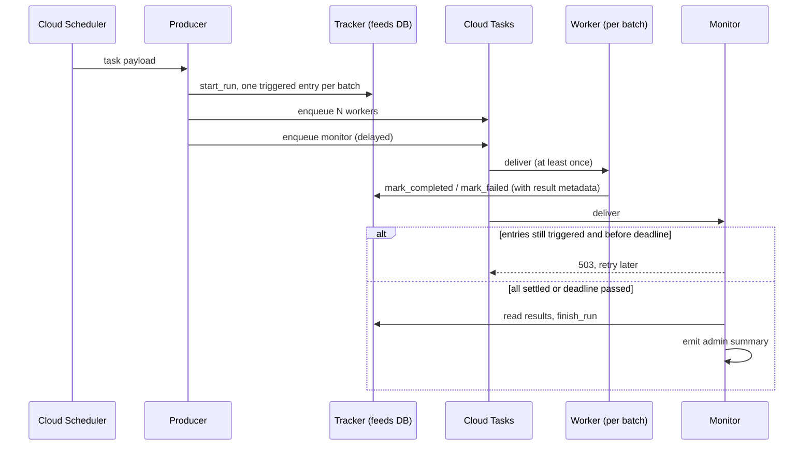

# Fan-out with a monitor

[Back to building blocks](README.md)

## Problem

Some runs cover the whole catalogue or every subscriber, which is too much for one
request. We split the run into small Cloud Tasks that run in parallel, and still need to
know when the whole run is finished, whether it succeeded, and to report it once.

## How it works

Three tasks executor handlers, with state kept by
[task execution tracking](task-execution-tracking.md):

- **Producer.** Counts the work, picks a fresh `run_id` (prefix + UTC timestamp),
  registers the run with one tracker entry per batch, enqueues one worker per batch and
  one delayed monitor. Supports `dry_run`, which only returns the plan.
- **Worker.** Processes one batch and reports `mark_completed(batch_id, metadata=result)`
  or `mark_failed`.
- **Monitor.** One per run, on its own queue with unlimited retries. While any entry is
  still `triggered` and the deadline has not passed, it raises `TaskInProgressError`
  (HTTP 503) and Cloud Tasks calls it again later. Then it aggregates the run's
  results, emits a summary, and calls `finish_run`. It changes the run's status only, never
  an entity's; see [Monitoring a run](task-execution-tracking.md#monitoring-a-run).



## Example

A producer only describes its work; `plan_fanout` does the rest. Condensed from
[`seal_orchestrator.py`](../../functions-python/tasks_executor/src/tasks/seal_of_reliability/orchestrator/seal_orchestrator.py):

```python
SPEC = FanoutSpec(
    task_name="seal_orchestrator_run",     # tracker task_name
    worker_task="seal_orchestrator_worker",
    run_id_prefix="seal",
    task_prefix="seal-orchestrator",
    log_name="seal_orchestrator",
)

plan_fanout(
    db_session,
    SPEC,
    count_feeds=lambda session: count_eligible_feeds(session),
    iter_batches=lambda session, size: iter_eligible_stable_ids(session, size),
    build_worker_payload=lambda run_id, batch_id, ids: {
        "run_id": run_id, "batch_id": batch_id, "stable_feed_ids": ids,
    },
    run_params=lambda started_at: {"run_started_at": started_at, "deadline_seconds": 3600},
    batch_size=250,
    dry_run=dry_run,
    monitor_delay_seconds=60,
)
```

## Rules and gotchas

- **Workers must be idempotent.** Cloud Tasks delivers at least once; use upserts or a
  tracker claim (notification workers claim each event before sending).
- **Use a fresh `run_id` per run.** Task names include it, so a rerun never collides with
  names Cloud Tasks still holds from the last run.
- **The monitor needs a deadline.** A worker that dies without reporting would otherwise
  keep the monitor polling forever.
- **Mark enqueue failures at once.** A batch that was never enqueued stays `triggered`
  until the deadline; `plan_fanout` marks it failed and reconciles the plan-time count
  against what the feed stream actually yielded.
- **Decide what an incomplete run means.** Seal runs settle as `failed` if any batch
  failed or never reported; notification dispatch settles as `completed`, because the
  summary is still useful.

## Operating it

- Dry run first: call the producer with `dry_run: true` to see the batch plan.
- Progress: tasks executor task `get_task_run_status` with the producer's `task_name` and
  the `run_id` it returned.
- Summaries arrive as `admin.event_summary` notifications (`dispatch_summary`,
  `seal_run_summary`).
- Monitor queues are configured in `infra/functions-python/main.tf`
  (`max_attempts = -1`, fixed backoff).

## Code map

- [`fanout.py`](../../functions-python/tasks_executor/src/tasks/seal_of_reliability/fanout.py):
  `FanoutSpec`, `plan_fanout`. Used by the nightly seal run and the seal backfill.
- Seal: `seal_orchestrator.py`, `seal_orchestrator_worker.py`, `seal_orchestrator_monitor.py`
  in `tasks_executor/src/tasks/seal_of_reliability/orchestrator/`.
- Notification dispatch: `dispatch_batch.py`, `dispatch_worker.py`, `dispatch_monitor.py`
  in `tasks_executor/src/tasks/notifications/`. Same shape, its own producer, one
  worker per subscription. See [notifications.md](../notifications.md#dispatcher-tasks-cloud-tasks-fan-out).
