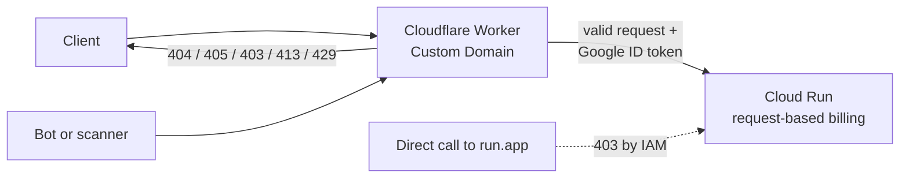
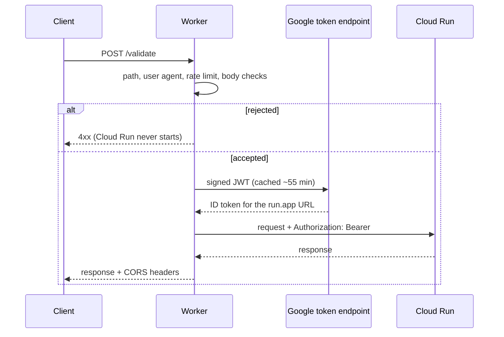
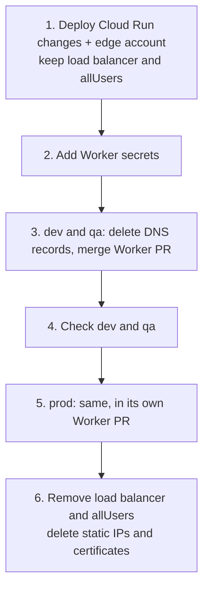

# Internet-facing API with rate limiting

[Back to building blocks](README.md)

An internet-facing API that limits each client, blocks bots, and caps its cost, without
any change for clients, with or without client authentication. Built with a Cloudflare Worker in front of Cloud Run.

## Problem

An internet-facing API on Cloud Run gets bot and scanner traffic. Each request can start an
instance, and we pay for it. Clients cannot change (no API keys, no captcha), so the
protection must be on the server side.

## How it works

A Cloudflare Worker sits in front of Cloud Run. It answers bots at the edge for free, and
only good requests reach Cloud Run. Cloud Run accepts calls only from the Worker.

The Worker:

1. Allows only the real endpoint (for example `POST /validate`) and the CORS preflight.
   Everything else gets 404 or 405.
2. Blocks known scanner user agents (403).
3. Rate limits per client IP (IPv6 by `/64`), then 429.
4. Checks the body: size limit, JSON, valid input. Bad input gets 400 or 413.
5. Signs the request with a Google ID token of an edge service account and forwards it.

Cloud Run:

- `roles/run.invoker` only for the edge service account. No `allUsers`.
- Request-based billing (`cpu_idle = true`): an idle instance costs nothing.
- `max_instance_count` is the cost ceiling.

## Example

Each API that uses the pattern has two parts:

| Part | Where |
|---|---|
| Worker site: checks, rate limit, forwarding, tests | Cloudflare Workers repository (private), `sites/<hostname>/` |
| Hostnames (Custom Domains) and rate limit binding | same repository, `wrangler.jsonc` |
| Cloud Run: instance cap, billing, edge service account | the API's infra repository (Terraform) |

First implementation: the GBFS validator API (`gbfs.api.mobilitydatabase.org`, plus
`dev.` and `qa.`). Bot traffic no longer starts instances. Cost before: about 200 CAD per
month for three environments (billing export). Expected after: under 10 CAD per month.

## Add it to a new API

1. **Cloud Run (Terraform):** `cpu_idle = true`, `max_instance_count`,
   `max_instance_request_concurrency`, `timeout`, ingress `ALL`, and a service account
   `<api>-edge-<env>` with `roles/run.invoker`.
2. **Size it with a load test** on dev, using real inputs of different sizes. Measure
   memory and time at the target concurrency. See [Watch out for](#watch-out-for).
3. **Worker:** add `sites/<hostname>/handler.js` (start from an existing API site), register the
   hostnames in `src/sites.js`, and add each hostname as a Custom Domain in
   `wrangler.jsonc`. Add tests and expected results.
4. **Secrets** (one pair per environment): the service account key and the run.app URL,
   with `wrangler secret put`. The key never goes into Terraform state or Git.
5. **Switch DNS:** delete the hostname's old A/AAAA records, then merge the Worker PR
   right away. The Custom Domain creates its own record and certificate.
6. **Check:** wrong path gives 404, a real request gives 200, a direct run.app call gives
   403.

If the API is already public behind a load balancer, switch without downtime in two steps:

## Not built yet: client tiers

Today every client gets the same limit (per IP). Planned: higher limits for known clients,
for example Mobility Database users or partners. The idea: the client sends a token, the
Worker verifies it and uses a per-user rate limit instead of the IP one. Clients without a
token keep the public limit. Document the design here with the first implementation.

## Rules

- Never ask clients to change. Filter on what every request already has: path, method,
  user agent, IP, body.
- The Worker must answer every rejected request itself. A rejected request must never
  start Cloud Run.
- Keep `allUsers` off Cloud Run once the switch is done. The run.app URL must return 403.
- Document every limit in one table (value, where to change it). Clients will ask.

## Watch out for

- **Deep hostnames need a Custom Domain.** The free Cloudflare certificate covers only
  one level (`*.example.org`). For `dev.api.example.org`, use a Workers Custom Domain.
- **Switching DNS causes a short outage.** Delete the old records, then merge the Worker
  PR right away. Some users may wait up to 30 minutes.
- **Java needs the heap setting.** Without it, Java uses only a quarter of the memory and
  fails on large inputs.
- **Concurrency depends on CPU, not memory.** Measure with real, large inputs before you
  pick the number per instance.
- **The rate limit is approximate.** It stops bots, but it is not an exact quota.
- **Test with a script client after the switch.** Zone-wide bot settings can block API
  clients.
