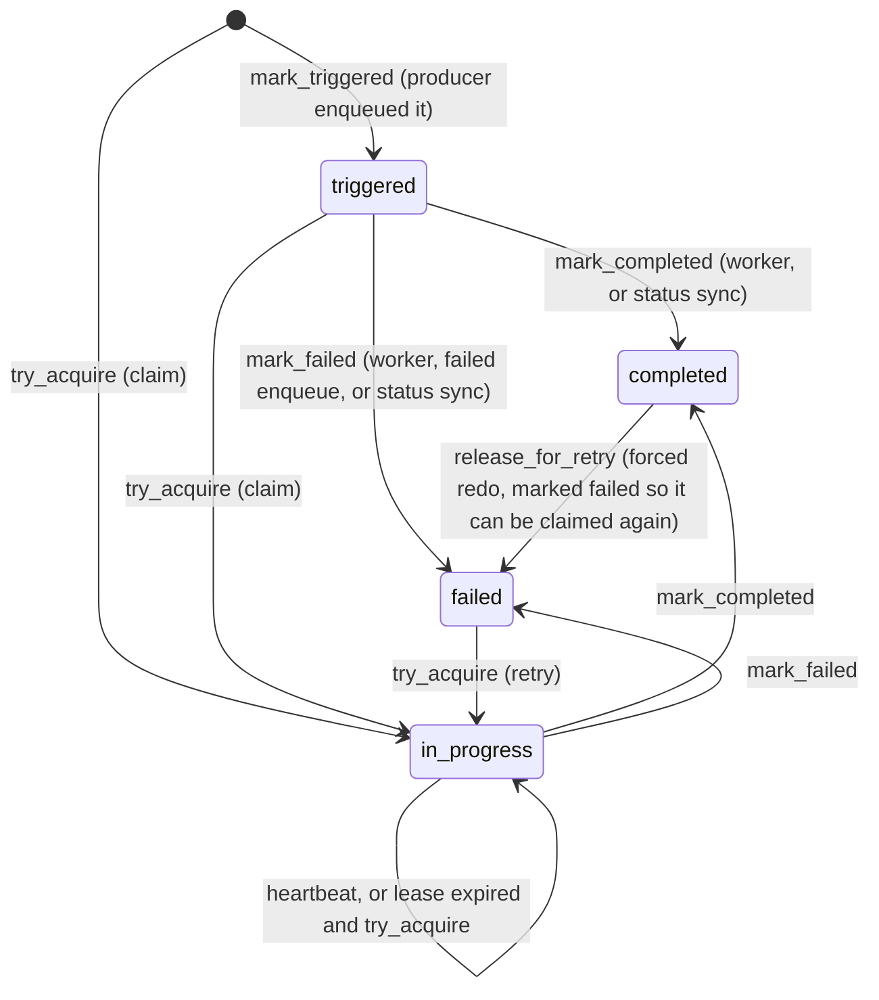
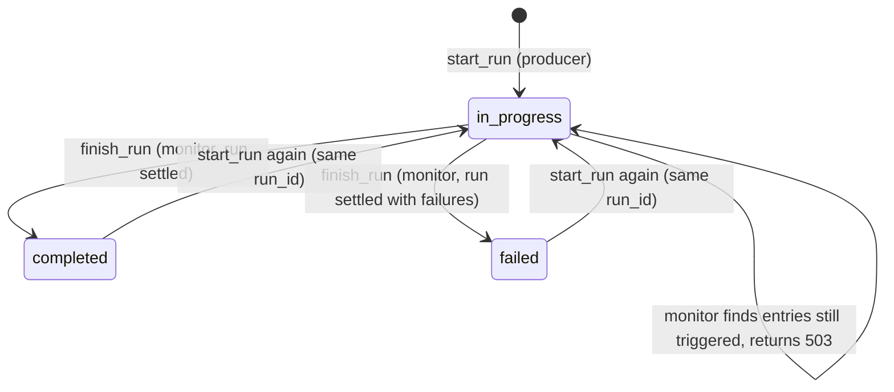

# Task execution tracking

[Back to building blocks](README.md)

## Problem

Background work here is spread over Cloud Tasks, retries, and instances that can be
killed at any time. Without durable state we cannot tell what finished, Cloud Tasks'
at-least-once delivery can run the same work twice, and retry caps or sizing decisions
have nothing to count. `TaskExecutionTracker` keeps that state in Postgres.

## How it works

Three tables in the feeds database, all keyed by `task_name` + `run_id`:

| Table | One row per | Answers |
|---|---|---|
| `task_run` | run (`task_name`, `run_id`) | Is the run going, done, or failed? How many entities? |
| `task_execution_log` | entity in a run (`entity_id`, may be null) | Where is this entity **now**? Rewritten in place. |
| `task_execution_attempt` | attempt | What **happened**? Append only: attempts, failure kind, peak memory. |

`run_id` is chosen by the caller and decides what "the same work" means: a validator
version, a converter version, or a timestamped run of a fan-out.

The state of one entity in `task_execution_log`. There are two paths: most work goes
straight from `triggered` to a result (fan-out workers, Workflows runs settled by the
status sync); work that must never run twice takes a claim and passes through
`in_progress` (the Parquet builder).



`failed` doubles as "claimable": `release_for_retry` uses it to reopen finished work, so a
`failed` row does not always mean an error happened. A forced redo shows as `failed` in
run counts until a worker claims it.

The state of the run in `task_run`:



`start_run` is an upsert that always resets the run to `in_progress`. That matters when
`run_id` is long-lived: the Parquet builder uses the converter version and calls
`start_run` on every build, with no monitor, so its `task_run` stays `in_progress` and its
status means nothing. Read entity rows or attempts for those tasks instead. Runs with a
fresh `run_id` per run (fan-out, timestamped) settle normally.

- `is_handled` is true for `triggered`, `in_progress` and `completed`. Only a missing row
  or `failed` is free to dispatch.
- `try_acquire` is an atomic conditional upsert: of several concurrent callers, exactly
  one gets `True`.
- A claim is a lease (30 minutes by default). A worker killed by OOM or timeout cannot
  release it, so it expires; `heartbeat` renews it during long work.
- `mark_completed(metadata=...)` stores a per-entity result; `get_summary` sums numeric
  fields and concatenates lists across the run, so no results table is needed.

## Monitoring a run

Workers write entity state; a monitor reads it to decide when the run is over. A monitor
is a tasks executor handler: while the run is not settled it raises `TaskInProgressError`
(HTTP 503) and Cloud Tasks calls it again after the queue's backoff. Fan-out monitor
queues retry without limit (`max_attempts = -1`, every 60s); the status sync queue stops
after 100 attempts, every 600s (about 17 hours).

| Monitor | Changes entity status | Settles the run when | Run ends as | Used by |
|---|---|---|---|---|
| Fan-out monitor (one per feature) | No; entries still `triggered` at the deadline stay as they are | `triggered == 0`, or the deadline passed | Seal: `failed` if any batch failed or never reported. Dispatch: always `completed`. | [Fan-out](fanout.md): seal of reliability, notification dispatch |
| Status sync (`sync_task_run_status`) | Yes: polls GCP Workflows and moves `triggered` to `completed` or `failed` | Nothing `triggered`, nothing `failed`, dispatch finished | `completed` only | Validation report rebuilds |

- The status sync is enqueued by the tracker itself: call `schedule_status_sync()` after
  `start_run`. Its task name is derived from `task_name` + `run_id`, so calling it twice
  is harmless.
- The status sync never settles while any entity is `failed`; it keeps polling until
  those are dispatched again and succeed, or the queue's retries run out.
- A fan-out monitor's deadline is what stops it polling forever; the queue never gives up.

## Example

A worker that must not run twice, condensed from
[`parquet_builder/src/main.py`](../../functions-python/parquet_builder/src/main.py):

```python
tracker = TaskExecutionTracker(
    task_name="parquet_generation", run_id=CONVERTER_VERSION, db_session=db_session
)
tracker.start_run(params={"converter_version": CONVERTER_VERSION})  # idempotent upsert

if force:
    tracker.release_for_retry(dataset_id)  # only touches `completed`

if not tracker.try_acquire(dataset_id, execution_ref=os.getenv("K_REVISION")):
    return {"status": "skipped", "reason": "already in progress"}
db_session.commit()  # commit the claim on its own

started_at = datetime.now(timezone.utc)
try:
    build(on_progress=lambda state: tracker.heartbeat(dataset_id, metadata=state))
    tracker.mark_completed(dataset_id, metadata=manifest)
    tracker.record_attempt(dataset_id, status="completed", started_at=started_at)
except Exception as error:
    db_session.rollback()
    tracker.mark_failed(dataset_id, error_message=str(error))  # releases the claim now
    tracker.record_attempt(dataset_id, status="failed", started_at=started_at, error=error)
    raise
finally:
    db_session.commit()
```

## Rules and gotchas

- **Claim in the worker, not in the producer.** `mark_triggered` is an upsert that always
  succeeds, so it records intent but does not lock.
- **Keep the lease above the worker's timeout**, so an instance GCP has not finished
  killing cannot have its work started a second time.
- **`completed` is never reclaimed** by `try_acquire`. Redo finished work only through
  `release_for_retry`.
- **`failed` means the attempt failed**, not that the entity is given up on; it is
  dispatchable again. Stop retrying with a cap from `attempts_since_success`, which
  resets after a success.
- **Pass the exception object** to `record_attempt`: `str(MemoryError())` is empty, so the
  class name is the only evidence.
- **Roll back before `mark_failed`** when the failure may have come from a commit; a
  failed session refuses every statement until it is rolled back.

## Operating it

- Run status: tasks executor task `get_task_run_status` with `task_name` and `run_id`.
- Attempt statistics per worker size: task `task_execution_stats` with `task_name`
  (`window_days` default 30).
- Runs backed by GCP Workflows: `schedule_status_sync` enqueues `sync_task_run_status`,
  which polls until the run settles.
- Ad hoc: query `task_execution_log` by `task_name`, `run_id`, `status`; read
  `task_execution_attempt` for history.

## Code map

- [`task_execution_tracker.py`](../../functions-python/helpers/task_execution/task_execution_tracker.py):
  the class; method docstrings are the full reference.
- Schema: `liquibase/changes/feat_task_execution_log.sql`,
  `liquibase/changes/feat_task_execution_attempt.sql`.
- Built on it: [Fan-out with a monitor](fanout.md), [T-shirt sizing](tshirt-sizing.md).
