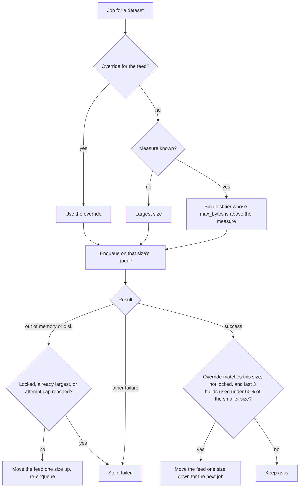

# T-shirt sizing

[Back to building blocks](README.md)

## Problem

A function provisioned for its worst case pays that price on every call. On
`pmtiles-builder-prod`, 85% of invocations finish within 30 seconds and use under 7% of
the compute, yet each one is billed at the memory the largest feed needs. T-shirt sizing
deploys the same source as several functions of different sizes and picks one per job.

## How it works

- **Tiers.** A routing table of sizes `S`, `M`, `L`, smallest first. Each tier has the
  largest measure it accepts (`max_bytes`, `None` for the last) and the memory it
  provides (`vms_budget_bytes`).
- **Deployment.** One function and one Cloud Tasks queue per size, named
  `<base>-<size>-<env>` and `<PREFIX>_QUEUE_<SIZE>`. A separate queue per size keeps a
  run of large jobs from blocking the small ones.
- **Measure.** The number that bounds the job. Each function chooses its own; the Parquet
  builder uses the largest uncompressed file, because its disk holds one file at a time.
- **Override.** A per-feed value in [per-feed configuration](README.md#per-feed-configuration)
  that decides the size on its own.
- **Self-healing.** A resource failure moves the feed up one size and retries. Repeated
  comfortable successes move it back down for the next job.

Routing a job, and what happens after it runs:



## Example

The Parquet builder's policy, from
[`helpers/parquet_policy.py`](../../functions-python/helpers/parquet_policy.py):

```python
SIZE_TIERS = (
    Tier(size=Size.S, max_bytes=256_000_000, vms_budget_bytes=1848 * MIB),    # 3Gi, 1Gi volume
    Tier(size=Size.M, max_bytes=1_500_000_000, vms_budget_bytes=3896 * MIB),  # 7Gi, 3Gi volume
    Tier(size=Size.L, max_bytes=None, vms_budget_bytes=7992 * MIB),           # 16Gi, 8Gi volume
)
SIZE_CONFIG_NAMESPACE = "parquet_builder"
```

Routing at enqueue time, condensed from
[`parquet_api_impl.py`](../../functions-python/operations_api/src/feeds_operations/impl/parquet_api_impl.py):

```python
routing = size_for_dataset(
    db_session, feed, dataset, tiers=SIZE_TIERS, namespace=SIZE_CONFIG_NAMESPACE
)
create_http_parquet_builder_task(
    feed_id, dataset_id, size=routing.size, variant_basis=routing.basis.value
)
```

Pinning a feed by hand, through the Operations API
(`PUT /v1/operations/feeds/{id}/config/parquet_builder/size`):

| Value | Meaning |
|---|---|
| `"l"` | Start on L; the builder may move it |
| `{"size": "l", "locked": true}` | Always L; never moved, never escalated |
| `{"size": "l", "source": "auto"}` | Written by the builder when it moves a feed up or down |

Moving a feed writes the auto override only when the new size differs from what the
measurement would pick; when they agree, the override is removed and the feed routes on
its measurement again.

## Rules and gotchas

- **Unknown measure routes to the largest size.** Size columns are nullable; guessing
  small turns a missing row into an OOM. The measure falls back from per-file sizes to
  the unzipped total to the archive size times 5.
- **An override is absolute.** It is not weighed against the measurement.
- **Overrides are stored only when they disagree with the measurement**, so a feed that
  shrinks leaves the list on its own.
- **Escalation is fast, demotion is slow.** Up after one resource failure; down only after
  3 builds in a row on that size, each under 60% of the smaller size's memory and disk.
- **Escalation is capped** (3 attempts since the last success) and never retries
  non-resource failures, so a broken feed cannot loop through the queues.
- **Code and Terraform must agree.** `vms_budget_bytes` mirrors `parquet_builder_sizes` in
  `infra/functions-python/main.tf`; each worker logs its real limit at startup.
- **Size tiers from peak VMS**, see [Work directory and memory](workdir-and-memory.md#threads-and-address-space).

## Operating it

- Attempts by size, peak memory, failures by kind: tasks executor task
  `task_execution_stats` with `task_name: parquet_generation`.
- Why a job ran where it did: `variant`, `variant_basis` (`measured`, `operator`, `auto`,
  `unknown`) and `escalated_to` on `task_execution_attempt`.
- Many `unknown` routings: run the `rebuild_missing_dataset_files` task to record sizes.

## Code map

- [`helpers/sizing.py`](../../functions-python/helpers/sizing.py): generic mechanism
  (`choose_size`, `escalate`, `demote`, `size_for_dataset`, overrides).
- [`helpers/parquet_policy.py`](../../functions-python/helpers/parquet_policy.py): the
  Parquet builder's tiers and thresholds.
- [`parquet_builder/README.md`](../../functions-python/parquet_builder/README.md#worker-sizes):
  measured numbers and the reasoning behind each tier.
- Attempts and claims: [Task execution tracking](task-execution-tracking.md).
