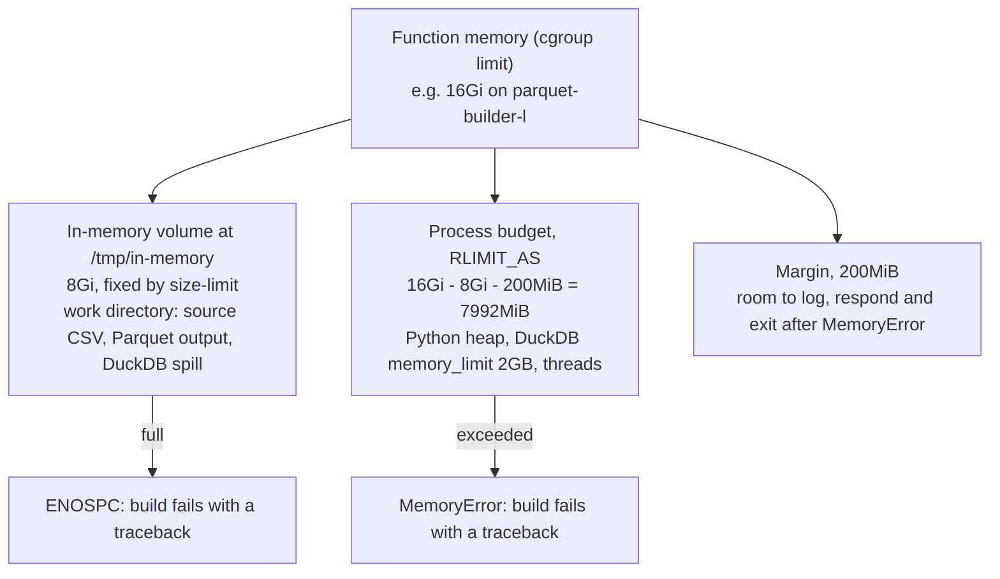

# Work directory and memory

[Back to building blocks](README.md)

## Problem

Cloud Run functions have no disk. Every file a function writes locally lives in memory,
in the same memory budget as the process that writes it. Builders that unpack a GTFS feed
and convert it write gigabytes of intermediate files, so "how much memory does this
function need" is really two questions: how much for the process, and how much for the
data on disk. This block answers both, and keeps the files of a killed run from leaking
into the next one.

## How it works

### One limit, two consumers

An instance has one memory limit (the cgroup limit, the function's `memory`). Two things
draw from it:

- **Process memory:** the Python heap, native libraries (DuckDB), and every thread the
  process starts.
- **Data:** files written under the work directory: the source file, its output, and
  DuckDB's spill files.

With an **in-memory volume** (a tmpfs with a fixed `size-limit`) the limit is split into
two separate budgets, each with its own failure:



`limit_gcp_memory(mount_point)` does the split at import time, before anything
allocates: it reads the cgroup limit and the volume's declared size, and sets `RLIMIT_AS`
on the process to the difference minus the margin. The volume is subtracted whether or
not anything is written to it.

**Without a volume** the work directory is ordinary container filesystem, which is also
memory but has no limit of its own. Process and data then compete for the whole limit,
and an overshoot gets the container killed by the kernel: no traceback, no failure
recorded, only a restarted instance.

### Threads and address space

`RLIMIT_AS` caps **address space** (VMS), not resident memory (RSS). Each thread reserves
address space for its stack and allocator that it may never touch, and DuckDB starts one
worker thread per CPU, so VMS runs 2 to 3 times RSS (measured on the Parquet builder).
Size the process budget from peak VMS; sizing from RSS is how the builder hit
`MemoryError` on a budget that looked generous.

DuckDB's spill directory sits inside the work directory. Spilling moves bytes from the
process budget to the volume; it does not free container memory. A large table can fill
the volume even when the process is well under its limit.

### The work directory

`EphemeralOrDebugWorkdir` creates one directory per job under the root
(`/tmp/in-memory` by default), named `<owner_prefix><prefix>` plus a random suffix:

1. **On enter:** delete sibling directories with the same `owner_prefix` older than
   `WORKDIR_MAX_AGE_SECONDS` (default 0, so all of them), then create a fresh one.
2. **On exit:** delete the directory.
3. **With `DEBUG_WORKDIR` set:** use that directory instead, and never delete or sweep.

The sweep on enter exists because a job killed by OOM or timeout never reaches its exit.
Its files stay in memory, and a warm instance reuses that memory for the next request.
Deleting everything with the owner prefix is safe only because these functions run one
request per instance (`max_instance_request_concurrency: 1`), so any sibling directory is
a leftover.

## Example

From [`parquet_builder/src/main.py`](../../functions-python/parquet_builder/src/main.py):

```python
TMPDIR = os.getenv("PARQUET_TMPDIR", "/tmp/in-memory")
MEMORY_BUDGET = limit_gcp_memory(TMPDIR)  # module import: before any allocation

with EphemeralOrDebugWorkdir(
    owner_prefix="parquet_", dir=TMPDIR, prefix=f"{dataset_stable_id}_"
) as workdir_name:
    workdir = Path(workdir_name)
    con = open_connection(temp_dir=workdir / "duckdb", memory_limit=DUCKDB_MEMORY_LIMIT)
    ...  # one source file and one output at a time, each deleted before the next
```

The volume itself is attached in `infra/functions-python/main.tf` (`gcloud run services
update --add-volume name=in-memory,type=in-memory,size-limit=...`), sized per worker in
`parquet_builder_sizes`.

## Who has what

| Function | Memory | In-memory volume | `limit_gcp_memory` | Work directory |
|---|---|---|---|---|
| Parquet builder (`s`, `m`, `l`) | 3Gi, 7Gi, 16Gi | 1Gi, 3Gi, 8Gi | yes | `EphemeralOrDebugWorkdir` |
| GTFS datasets comparer | 8Gi | 3Gi (`gtfs_datasets_comparer_in_memory_size`) | yes | DuckDB spill; datasets read from a bucket mount |
| PMTiles builder | 16Gi | none | no | `EphemeralOrDebugWorkdir` |
| `batch_process_dataset` | 8Gi | none | yes, but finds no volume, so the process may use the full limit minus the margin | a temp `.zip` under `WORKING_DIR` |

The last two run without a data budget: a large feed is killed rather than failed.

## Rules and gotchas

- **Use a volume when the data is large.** It is the only thing that bounds the data side
  and turns an OOM kill into a catchable error.
- **Keep memory and volume together.** The volume is carved out of `memory`, not added to
  it; change both in the same Terraform map.
- **Size the volume from the largest single file**, plus its output and the spill, not
  from the archive or the feed total. Stream sources so only one is on disk at a time.
- **Check the cold-start log.** `total tmpfs size: 0.00 MiB` means the volume is not
  mounted and the process has the whole limit: a broken deploy, not a safe one.
- **Pick a unique `owner_prefix`.** The root is shared; the prefix is the only thing that
  stops one function's sweep from deleting another's files.
- **Do not raise request concurrency** on a function that uses the work directory with
  the default TTL: the sweep would delete a concurrent job's files.
- **Size from VMS, not RSS, and never from `tracemalloc`.** `tracemalloc` (the `memory:`
  figure from `track_metrics`) sees Python allocations only, not DuckDB or tmpfs pages;
  use `MemorySampler`'s peak VMS.

## Operating it

- Cold start logs: `Process memory limit ... total tmpfs size ... available ...` and
  `RLIMIT_AS set to ...`.
- Per build: `peak_rss_bytes` and `peak_vms_bytes` on `task_execution_attempt`, and the
  `task_execution_stats` task for the distribution per worker size.
- Locally: set `DEBUG_WORKDIR` to keep the intermediate files for inspection.

## Code map

- [`helpers/ephemeral_workdir.py`](../../functions-python/helpers/ephemeral_workdir.py): the
  work directory.
- [`api/src/shared/common/gcp_memory_utils.py`](../../api/src/shared/common/gcp_memory_utils.py):
  `limit_gcp_memory`, `MemoryBudget`.
- [`helpers/runtime_metrics.py`](../../functions-python/helpers/runtime_metrics.py):
  `MemorySampler`, `track_metrics`.
- [`parquet_builder/README.md`](../../functions-python/parquet_builder/README.md#memory):
  measured numbers for each worker size.
- Related: [T-shirt sizing](tshirt-sizing.md) uses these budgets to choose a worker.
