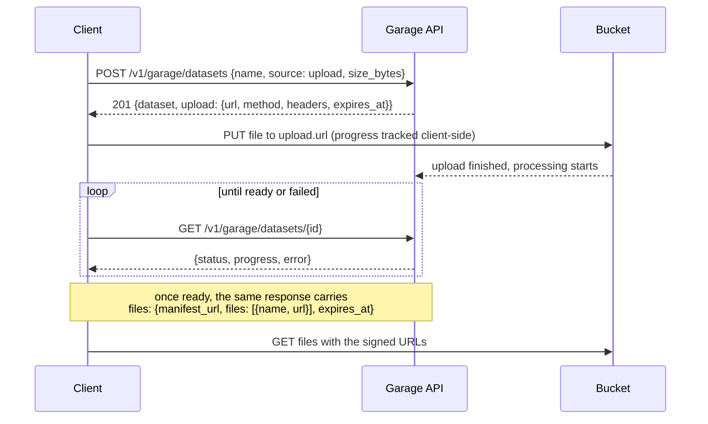
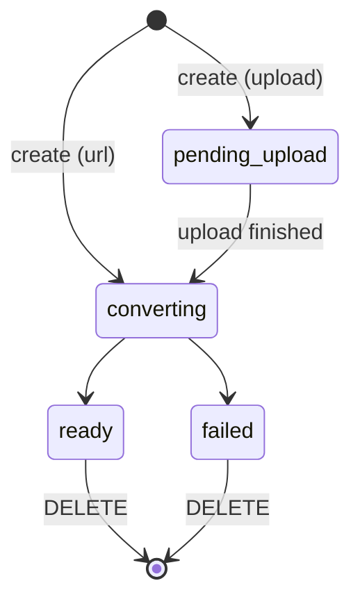

# Garage API
Cloud Function serving a user's datasets in the GTFS Garage, behind the load balancer at `/v1/garage`.
The OpenAPI schema lives at `../../docs/GarageAPI.yaml`.

> Note: the endpoints are not implemented yet and return 501 once access is granted.
> Do not edit generated code under `src/garage_gen/`; put implementation under `src/garage/impl/`.

## Access
Every request needs an MDB access token (checked by IAP at the load balancer) and the `userDatasets`
feature flag on the user (checked by `GarageAccessMiddleware`): 401 without a user, 403 without the flag.
The flag is created and granted through the Operations API.

## Client flow
Files never pass through the API: the client uploads to, and reads from, the bucket with signed URLs.
Processing starts on its own when the upload finishes.



To reopen a dataset later (new session, or after the URLs expire), list with `GET /v1/garage/datasets`
and call `GET /v1/garage/datasets/{id}` again for fresh URLs.

For `source: url` the client skips the upload: processing starts when the dataset is created.



`GET /v1/garage/datasets` lists the user's datasets; `DELETE /v1/garage/datasets/{id}` removes one and its files.

# Function configuration
- `USERS_DATABASE_URL`: the users database, for the feature flag.
- `S2S_JWT_SECRET`: verifies the website's `x-mdb-user-context` header.
- `CORS_ALLOWED_ORIGINS`: comma separated web origins.
- `GARAGE_BUCKET_NAME`: the bucket holding the user's datasets.

# Useful scripts
- Generate the server stubs:
```
./scripts/api-garage-gen.sh
```
- Run the function locally:
```
./scripts/function-python-run.sh --function_name garage_api
```
- Run the tests:
```
./scripts/api-tests.sh --folder functions-python/garage_api
```
