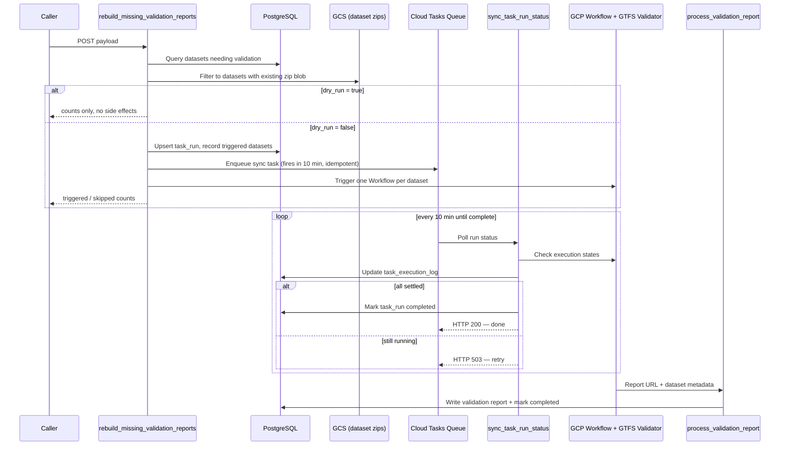

# GTFS Validation Report Tasks

This module contains two tasks for managing GTFS validation reports at scale:

| Task ID | Purpose |
|---|---|
| `rebuild_missing_validation_reports` | Triggers GCP Workflows to (re)validate datasets |
| `sync_task_run_status` | Generic self-scheduling monitor for any task_run |

---

## Architecture



---

## `rebuild_missing_validation_reports`

Finds GTFS datasets that are missing a validation report **or** have a report from an
older validator version, then triggers a GCP Workflow for each one.

By default "older version" means "not the exact version returned by the validator
endpoint". Set `filter_validator_version_prefix` (e.g. `"8."`) to instead target
datasets that lack **any** report matching that major-version prefix — useful when you
want to re-validate everything missing an `8.*` report regardless of the exact patch
version the endpoint reports.

By default the task only considers **each feed's latest dataset**. Set
`include_all_datasets: true` to consider **every** dataset of the feed — needed when
backfilling a historical window (e.g. so a feed's six-month reliability window is
complete), not just its most recent dataset.

The task is **resumable**: if it times out mid-loop, calling it again skips datasets
that were already triggered (tracked in `task_execution_log`).

After a gtfs-validator release, [`validator-update.yml`](../../../../../.github/workflows/validator-update.yml)
schedules this task 24 hours later with `force_update: true`, so that the latest datasets get a
report from the new version (see [Validator releases](../../../../../docs/ValidatorRelease.md)). The comparison of a new version with the last release is done before
the release, by the gtfs-validator acceptance tests (see its
[release steps](https://github.com/MobilityData/gtfs-validator/blob/master/docs/RELEASE.md)).

### Payload

```json
{
    "dry_run": true,
    "filter_after_in_days": 30,
    "filter_downloaded_after": "2026-03-01",
    "filter_downloaded_before": "2026-06-01",
    "filter_statuses": ["active"],
    "filter_op_statuses": ["published"],
    "filter_validator_version_prefix": "8.",
    "force_update": false,
    "limit": 10
}
```

| Field | Type | Default | Description |
|---|---|---|---|
| `dry_run` | bool | `true` | Count candidates only — no workflows triggered |
| `validator_endpoint` | string | env-derived | Validator service URL to use and fetch version from |
| `filter_after_in_days` | int | `null` | Restrict to datasets downloaded within the last N days. Omit to include all datasets |
| `filter_downloaded_after` | string (ISO date) | `null` | Restrict to datasets downloaded **at or after** this date (inclusive), e.g. `"2026-03-01"`. Omit for no lower bound |
| `filter_downloaded_before` | string (ISO date) | `null` | Restrict to datasets downloaded **strictly before** this date (exclusive), e.g. `"2026-06-01"`. Omit for no upper bound |
| `filter_statuses` | list[str] | `null` | Filter feeds by status (e.g. `["active", "inactive"]`). Omit for all statuses |
| `filter_op_statuses` | list[str] | `["published"]` | Filter feeds by operational status. Accepted values: `"published"`, `"unpublished"`, `"wip"` |
| `filter_validator_version_prefix` | string | `null` | When set (e.g. `"8."`), only include datasets that do **not** already have a report whose `validator_version` starts with this prefix. Overrides the default exact-version comparison |
| `include_all_datasets` | bool | `false` | When `true`, consider **all** datasets of each feed, not just the latest one. Use for backfilling a historical window |
| `force_update` | bool | `false` | Re-trigger even when a current report already exists |
| `limit` | int | `null` | Cap the number of workflows triggered per call — useful for end-to-end testing |

---

## `sync_task_run_status`

Generic self-scheduling monitor for any `task_run` tracked by `TaskExecutionTracker`.
Automatically scheduled by `rebuild_missing_validation_reports` on every non-dry run.

### Behaviour

1. Polls GCP Workflows Executions API for all `triggered` entries with an `execution_ref`
2. Updates statuses (`triggered → completed / failed`)
3. If all done → marks `task_run.status = 'completed'`
4. If still in progress → re-schedules itself as a Cloud Task after `sync_delay_seconds`

### Payload

```json
{
    "task_name": "gtfs_validation",
    "run_id": "7.0.0",
    "sync_delay_seconds": 600
}
```

| Field | Type | Default | Description |
|---|---|---|---|
| `task_name` | string | **required** | Task name identifier (e.g. `"gtfs_validation"`) |
| `run_id` | string | **required** | Run identifier — the validator version string |
| `sync_delay_seconds` | int | `600` | Seconds between polling cycles |

### Response

Same as `get_validation_run_status` (which this task replaces):

```json
{
    "task_name": "gtfs_validation",
    "run_id": "7.0.0",
    "run_status": "in_progress",
    "total_count": 5000,
    "total_candidates": 5000,
    "dispatch_complete": true,
    "triggered": 200,
    "completed": 4800,
    "failed": 0,
    "pending": 0,
    "failed_entity_ids": [],
    "ready_for_bigquery": false
}
```

| Field | Meaning |
|---|---|
| `total_count` | Datasets intended to be triggered in the current call (respects `limit`) |
| `total_candidates` | Total datasets needing validation (before `limit` slicing) |
| `dispatch_complete` | `false` → `rebuild_missing_validation_reports` timed out; call it again |
| `pending` | Datasets not yet triggered (`> 0` means dispatch loop is incomplete) |
| `triggered` | Dispatched but report not yet processed |
| `ready_for_bigquery` | `true` when all workflows finished with no failures and task_run is marked completed |

---

## GCP Environment Variables

| Variable | Default | Description |
|---|---|---|
| `ENV` | `dev` | Environment (`dev`, `staging`, `prod`) |
| `LOCATION` | `northamerica-northeast1` | GCP region |
| `GTFS_VALIDATOR_URL` | env-derived | Override the validator URL (takes priority over `ENV`) |
| `BATCH_SIZE` | `5` | Number of workflows triggered per batch before sleeping |
| `SLEEP_TIME` | `5` | Seconds to sleep between batches |
| `TASK_RUN_SYNC_QUEUE` | Terraform-injected | Cloud Tasks queue used by `sync_task_run_status` self-scheduling |
